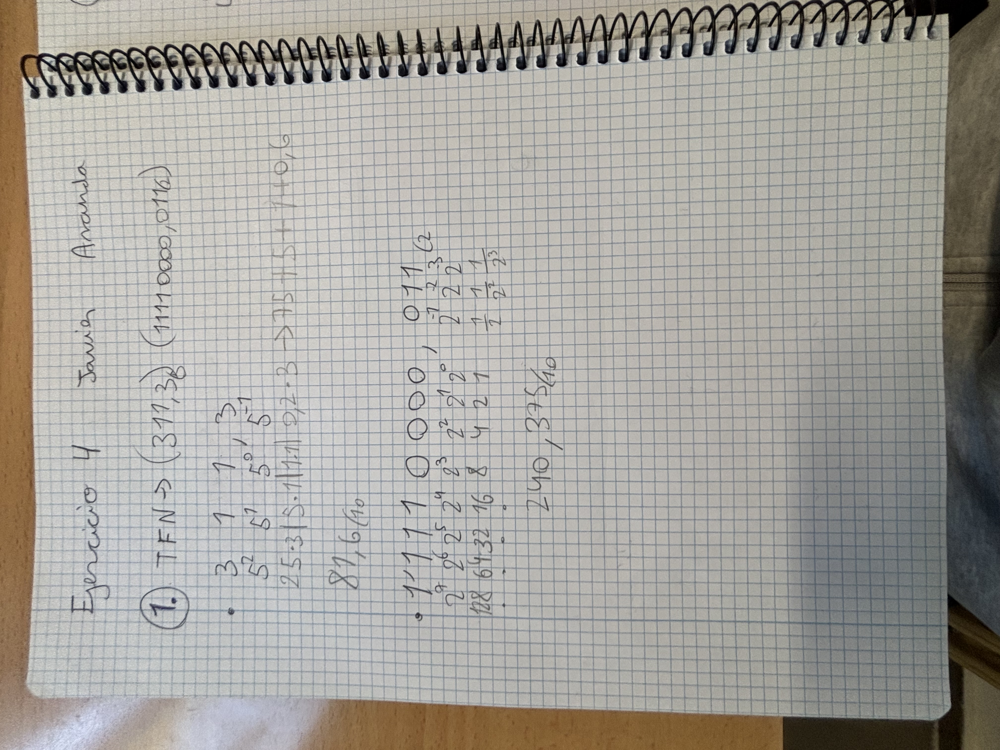
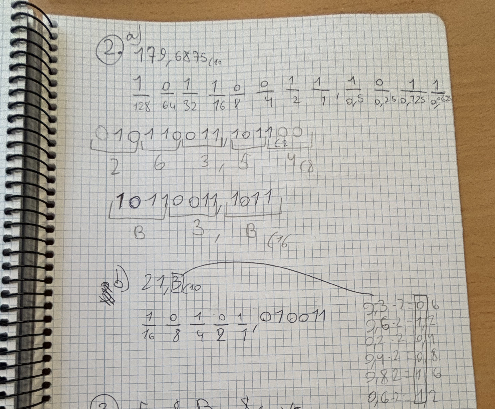
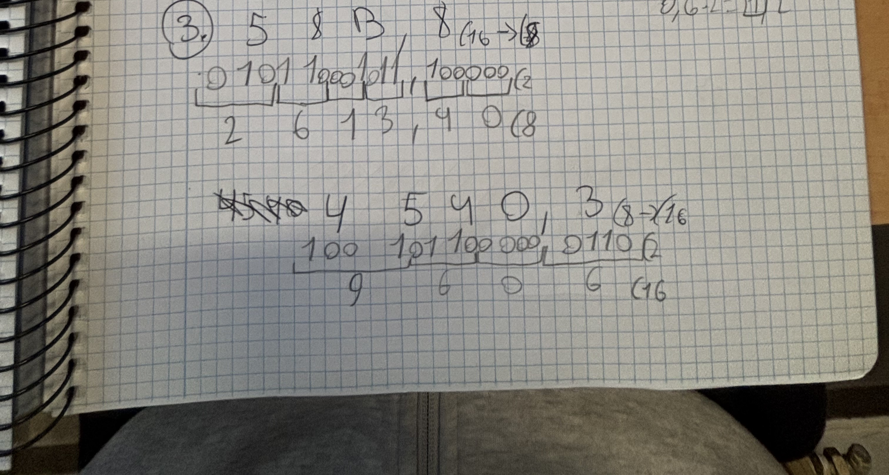
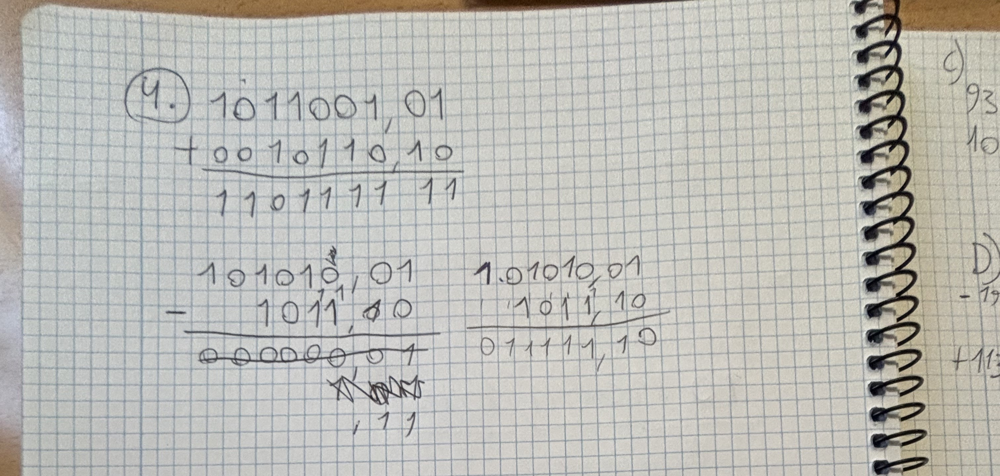
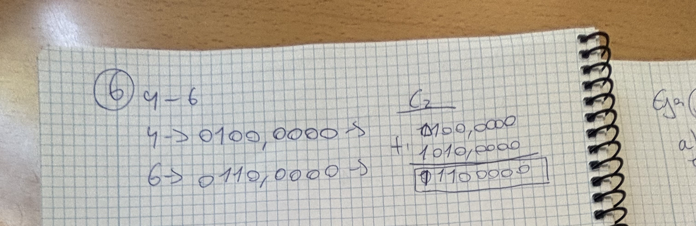
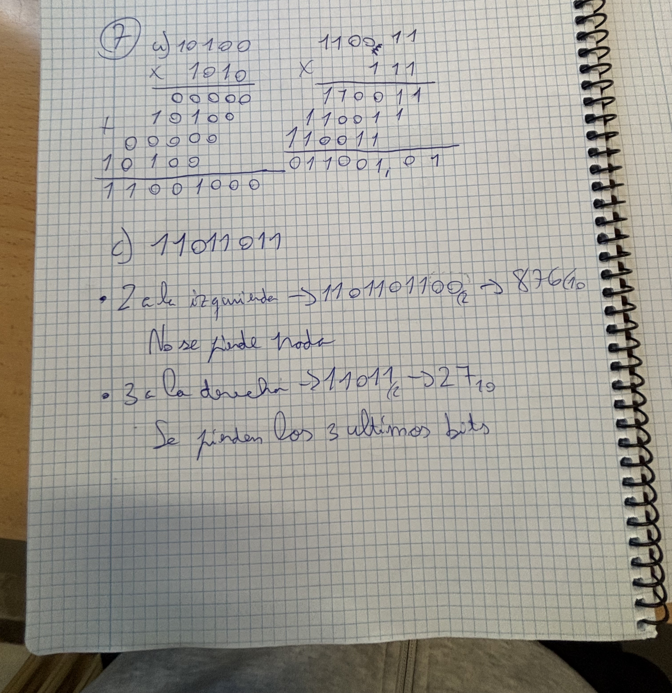
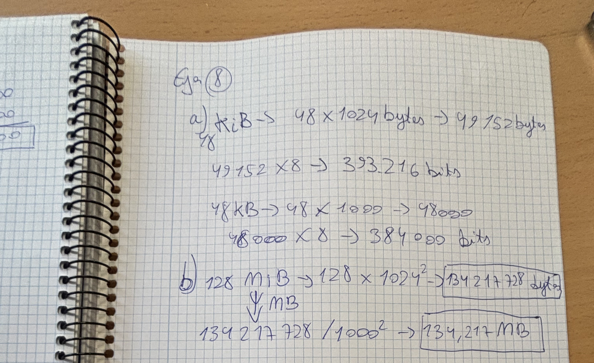
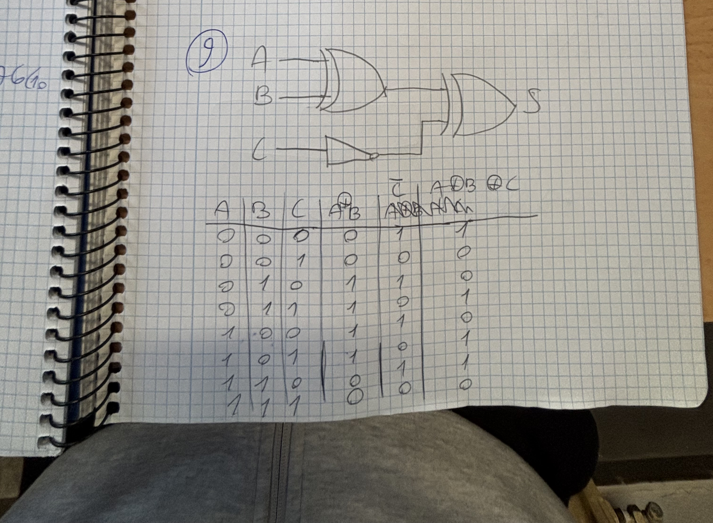
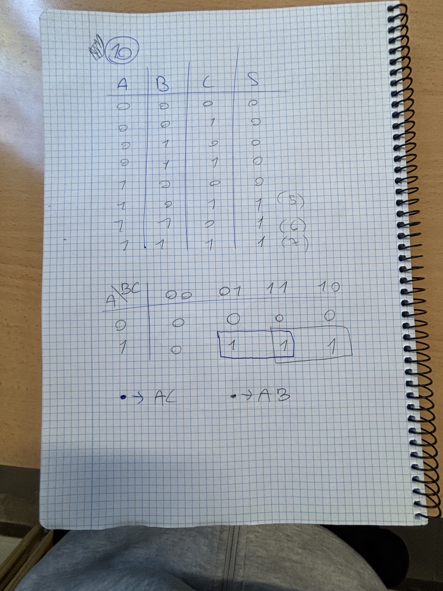

# Resultados Ejercicios - Javier Aranda

##Ejercicio 1

- Apartado 1: 81,6_(10)

- Apartado 2: 240,375_(10)

##Ejercicio 2

- Apartado a: 179,6875_(10)

- Apartado b: 263,54_(8)

- Apartado c: B3,B_(16)

##Ejercicio 3

- Resultado: 2613,4_(8)

##Ejercicio 4

- Suma: 1101111,11

- Resta: 0000000,1

##Ejercicio 5

- Apartado a: 26

- Apartado b: 10100010

- Apartado c: 11000101

- Apartado d: 01101110

##Ejercicio 6

- Resultado: 01100000

##Ejercicio 7

- Multiplicación a: 1111101000

- Multiplicación b: 011001,01

- Desplazamiento a la izquierda (2 bits): 876_(10)

- Desplazamiento a la derecha (3 bits): 27_(10)

##Ejercicio 8

- Apartado a: 393.216 bits / 384.000 bits

- Apartado b: 134,217 MB

##Ejercicio 9

- Expresión lógica: S = (A (+) B) (+) C

- Tabla de verdad:

A | B | C | C! | A (+) B | (A (+) B) (+) C! | S

--+---+---+-------+---------+---------------------+---

0 | 0 | 0 |   1   |    0    |          1          | 1

0 | 0 | 1 |   0   |    0    |          0          | 0

0 | 1 | 0 |   1   |    1    |          0          | 1

0 | 1 | 1 |   0   |    1    |          1          | 0

1 | 0 | 0 |   1   |    1    |          0          | 1

1 | 0 | 1 |   0   |    1    |          1          | 0

1 | 1 | 0 |   1   |    0    |          1          | 1

1 | 1 | 1 |   0   |    0    |          0          | 0

##Ejercicio 10

- Funciones simplificadas: AC y AB

